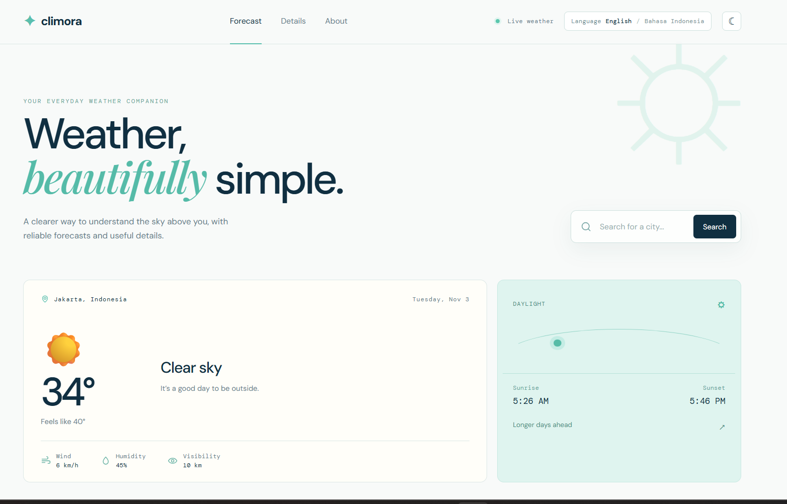
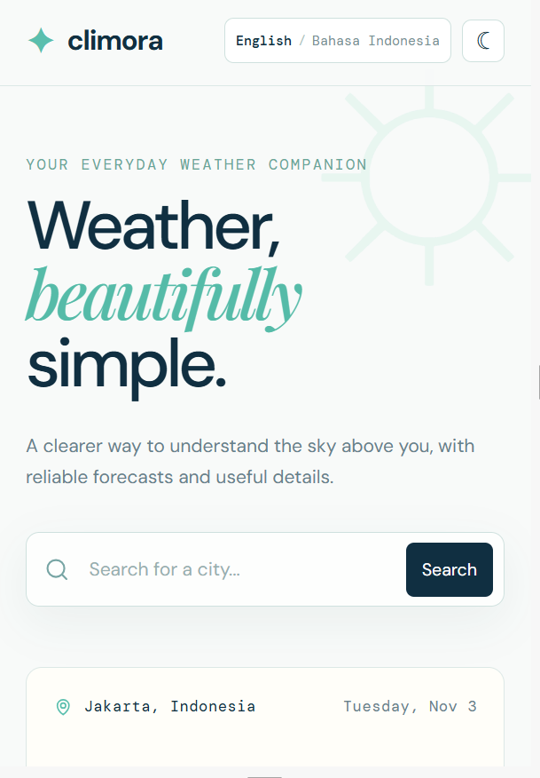

# Climora Weather App

Climora is a responsive weather dashboard built with React and Vite. It presents current conditions and a seven-day forecast in a clean interface designed for everyday planning.

## Screenshots

Climora is designed to provide a consistent experience across screen sizes, with a spacious desktop layout and a focused mobile interface.

### Desktop preview



### Mobile preview



## Features

- Live weather data from the Open-Meteo API
- City search with geocoding suggestions
- Current conditions, sunrise, sunset, and seven-day forecast
- English and Bahasa Indonesia language switcher
- Responsive layout for desktop, tablet, and mobile
- Loading and error states

## Tech stack

React · Vite · JavaScript · CSS · Open-Meteo API

## Run locally

```bash
npm install
npm run dev
```

Open `http://localhost:5173` in your browser.

## Data source

Weather and geocoding data are provided by [Open-Meteo](https://open-meteo.com/). Forecasts are estimates and may change as atmospheric conditions evolve.

## Author

© 2026 @azizanonerm
